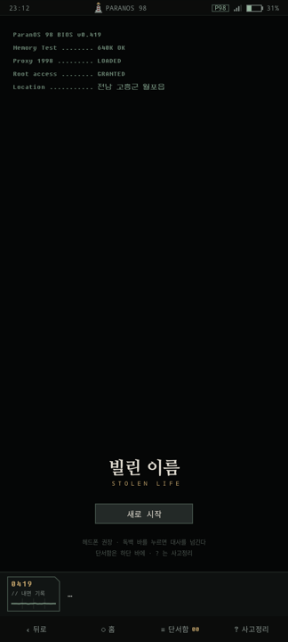
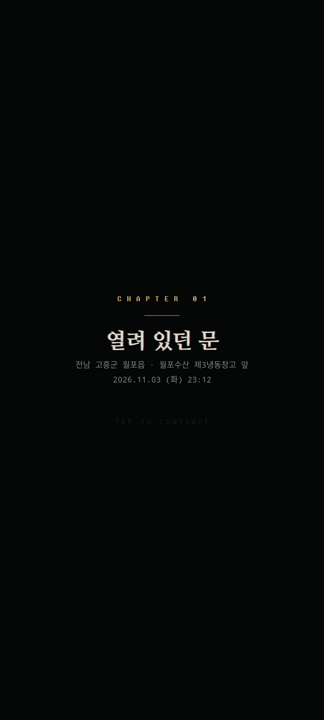
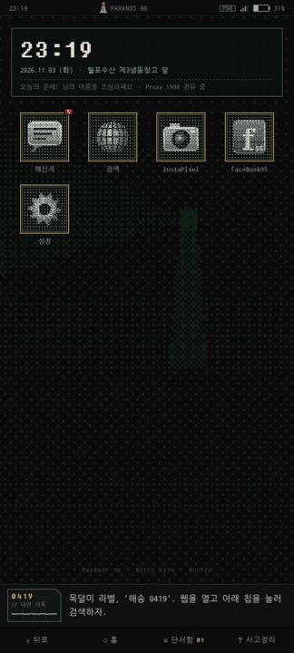

# 빌린 이름 (Stolen Life)

> 20년 만에 문이 열렸다. 손에 남은 건 1998년식 운영체제가 깔린 낡은 전화기 한 대.

1998년 감성의 가상 휴대폰 **ParanOS 98** 안에서 단서를 모으고, 문장과 문장을 맞대어 진실을 추적하는 텍스트 추리 게임입니다.
웹 프로토타입(HTML)을 **Kotlin + Jetpack Compose** 네이티브 안드로이드 앱으로 옮겼습니다.

<p align="center">
  
  
  
</p>

## 이야기

정신요양원 환자복 라벨에 적힌 번호 `해송 0419`.
주인공은 자신이 *인생을 도둑맞은 남자*라고 믿고, 정체를 알 수 없는 조력자 **WATSON**이 건넨 전화기로 과거를 파헤치기 시작합니다.
검색은 키보드 없이 **단서 칩**으로만 할 수 있습니다. 키보드를 쓰면 추적당하니까요.

| 챕터 | 제목 | 장소 |
|---|---|---|
| 1 | 열려 있던 문 | 월포수산 제3냉동창고 앞 |
| 2 | 몸이 먼저 기억한다 | 파란여관 203호 |
| 3 | 거울 속의 타인 | 파란여관 203호, 포위망 |

## 플레이 방법

- **단서 칩:** 문서에 밑줄 그어진 단어를 누르면 칩으로 모입니다. 하단 바의 `단서함`에서 칩을 골라 검색합니다.
  분류 탭: `[ALL] [PER] [LOC] [NUM] [ORG] [ACC]`
- **[PIN] 교차검증:** 붉은 밑줄 문장을 눌러 고정하고, 다른 문서의 문장과 대조해 추리를 완성합니다.
- **잠금 해제:** 웹하드 · 클라우드 · 금고는 문서 속 숫자를 찾아 키패드로 엽니다.
- **독백 바:** 화면 아래 `0419 // 내면 기록`을 누르면 대사가 넘어갑니다.
- **막히면:** 하단 바의 `? 사고정리`가 다음에 할 일을 알려 줍니다.
- **시연용:** 게임 속 `설정` 앱에서 2장 · 3장 · 엔딩 직전으로 바로 이동할 수 있습니다.

헤드폰을 권장합니다. 효과음과 챕터별 배경음은 음원 파일 없이 코드로 실시간 합성됩니다.

## 실행하기

**요구 사항:** Android Studio (최신 안정판), JDK 17 이상, Android 8.0(API 26) 이상 기기 또는 에뮬레이터

1. 저장소를 받습니다.
   ```bash
   git clone https://github.com/ddss88819897-stack/StolenLife.git
   ```
2. Android Studio에서 **File → Open**으로 `StolenLife` 폴더를 열고 Gradle Sync가 끝나길 기다립니다.
   (`local.properties`는 Android Studio가 자동으로 만듭니다.)
3. 기기를 고르고 ▶ **Run**을 누릅니다.

터미널에서 빌드하려면:

```bash
./gradlew :app:installDebug
```

테스트:

```bash
./gradlew :app:testDebugUnitTest
```

## 기술 스택

| 영역 | 사용 기술 |
|---|---|
| 언어 · UI | Kotlin, Jetpack Compose (Material 3 최소 사용) |
| 구조 | 단일 Activity, MVVM, `StateFlow` |
| 화면 이동 | Navigation Compose (타입 안전 라우트) + ViewModel이 관리하는 앱 내부 스택 |
| 저장 | DataStore Preferences + kotlinx.serialization (자동 저장 · 이어하기) |
| 소리 | `AudioTrack` 실시간 합성 (사각파 · 삼각파 · 톱니파, 챕터별 배경음) |
| 진동 | `VibratorManager` (칩 획득 틱 · 오답 이중 진동 · 엔딩 연속 진동) |
| 그래픽 | Canvas 1-bit Bayer 디더링 픽셀아트, CRT 스캔라인, 색수차(API 31+) |

### 디자인 원칙

- 이모지 없음. `[SEARCH >]`, `[LOCKED //]`, `[PIN]` 같은 텍스트 태그를 씁니다.
- 둥근 모서리와 그라데이션 없음. 1px 베벨과 2dp 하드 섀도만 씁니다.
- 위 규칙은 `StyleGuardTest`가 빌드할 때마다 검사합니다.

## 프로젝트 구조

```
app/src/main/java/kr/paranos/stolenlife/
├── MainActivity.kt          몰입 모드, 소리 · 진동 연결
├── data/                    게임 데이터(GameRepository), 상태 모델, 저장소
├── viewmodel/               GameViewModel, 독백 엔진, UI 상태 모델
├── feedback/                효과음 합성(ToneSynth), 배경음(AmbientSynth), 진동
└── ui/
    ├── StolenLifeApp.kt     화면 전체 레이어 구성
    ├── theme/               색 · 서체 · 테마
    ├── components/          문서 뷰, 단서함, 키패드 · 교차검증 창, 오실로스코프 등
    └── screens/             홈, 메신저, 검색, 파란누리, 금고, 203호, 설정, 부팅
```

## 서체와 라이선스

| 서체 | 쓰임 | 라이선스 |
|---|---|---|
| 나눔명조 | 문서 · 챕터 제목 | SIL Open Font License 1.1 |
| 나눔고딕코딩 | UI 본문 | SIL Open Font License 1.1 (`assets/fonts/OFL-NanumGothicCoding.txt`) |
| 둥근모꼴 | 시계 · 키패드 · 터미널 | SIL Open Font License 1.1 |

서체 파일은 각 라이선스에 따라 함께 배포합니다. 게임 속 인물 · 단체 · 지명은 모두 허구입니다.
